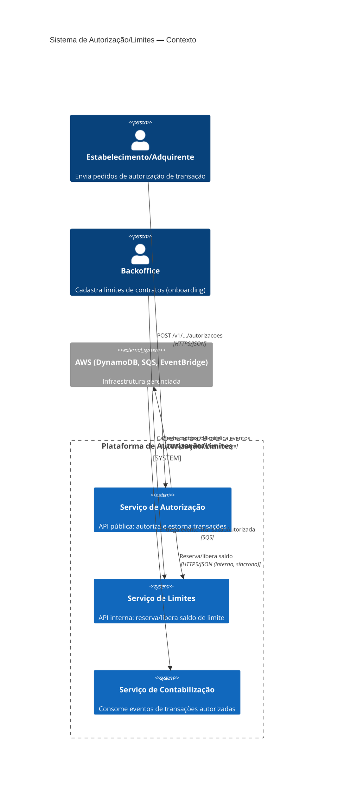

# C4 — Nível 1: Diagrama de Contexto

## Notas

- **Estabelecimento/Adquirente** é o único consumidor externo da API pública (ver `contracts/openapi.yaml`).
- **Backoffice** representa o processo de onboarding que cadastra limites — fora do escopo do desafio, modelado aqui apenas como ator de contexto (ver ADR 01).
- A comunicação entre Autorização e Limites é síncrona e interna (chamada de rede dentro da plataforma, nunca exposta externamente) — ver ADR 04 para a saga leve entre os dois bounded contexts.
- Contabilização nunca é chamada diretamente; ela reage a eventos de domínio via Outbox + Relay + EventBridge + SQS (ver ADR 02).
