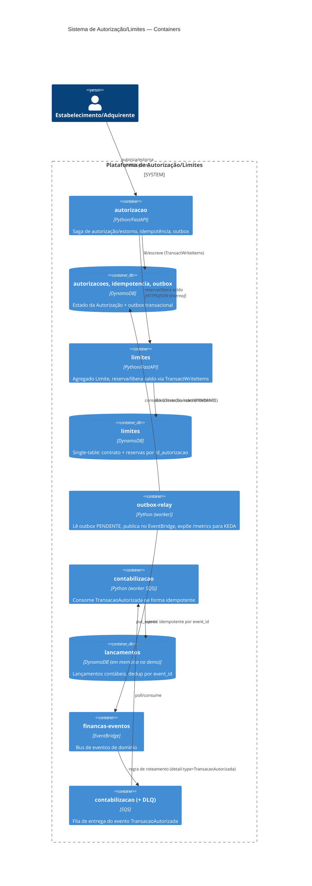

# C4 — Nível 2: Diagrama de Containers

## Notas

- Cada bounded context tem seu **próprio banco de dados** (ver ADR 01) — não há acesso cross-service a tabelas.
- `autorizacao` → `limites` é uma chamada **síncrona** (HTTP interno); todo o resto é **assíncrono** via outbox/EventBridge/SQS.
- `outbox-relay` é um worker **genérico**: depende apenas dos ports `OutboxSource`/`EventPublisher` — hoje só lê a outbox de `autorizacao`, mas poderia ser reaproveitado por outro bounded context no futuro sem alterações de código (apenas nova configuração de wiring).
- Em produção (EKS), `relay` escala via KEDA `metrics-api` contra seu próprio `/metrics`; `contabilizacao` escala via KEDA `aws-sqs-queue` contra a profundidade da fila — ver ADR 05 e `deploy/k8s/`.
