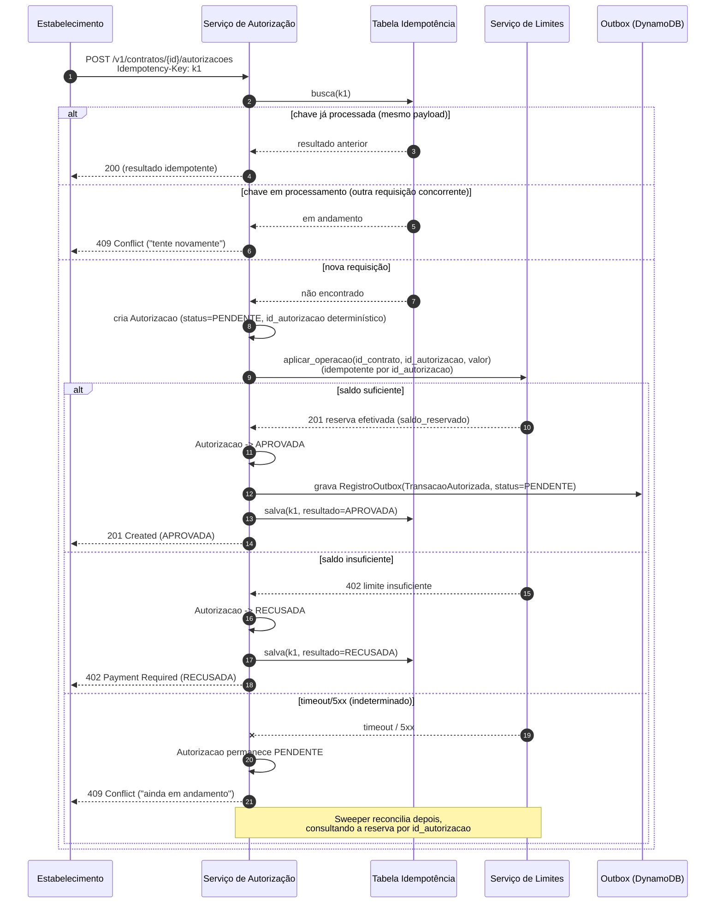

# Sequência — Autorização de Transação (saga leve)

Cobre o caminho feliz (aprovação), a recusa por limite insuficiente, e o
caso de falha indeterminada (timeout/5xx) tratado pela saga (ver ADR 04).

## Notas

- `id_autorizacao` é determinístico a partir da `Idempotency-Key` (hash), permitindo reenviar a mesma reserva com segurança.
- A reserva em Limites usa `TransactWriteItems` com condição `saldo_reservado + valor <= limite_total` (ver ADR 03) — a concorrência entre autorizações do mesmo contrato é resolvida atomicamente lá, não em Autorização.
- O corpo 409 e 402 segue RFC 7807 (`application/problem+json`), ver `contracts/openapi.yaml`.
