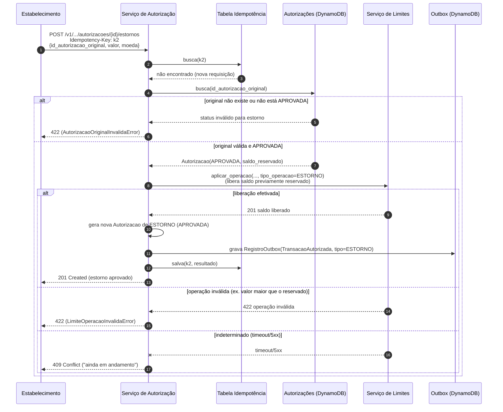

# Sequência — Estorno de Autorização

## Notas

- O estorno referencia a autorização original via `id_autorizacao_original` — o campo existe especificamente para permitir rastrear a cadeia autorização → estorno (ver decisões da conversa anterior).
- Reaproveita a mesma tabela de idempotência e a mesma outbox da autorização original — um estorno também publica seu próprio evento `TransacaoAutorizada` (com `tipo_operacao=ESTORNO`), permitindo que Contabilização registre o lançamento de reversão.
