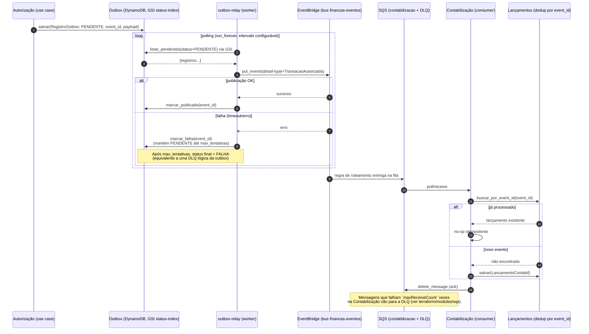

# Fluxo do Evento — Outbox → Relay → EventBridge → SQS → Contabilização

## Notas

- O **worker outbox-relay é genérico** (ports `OutboxSource`/`EventPublisher`) — hoje lê apenas a outbox de Autorização, mas o mesmo binário poderia ler a outbox de qualquer outro bounded context que a implementasse.
- `/metrics` do outbox-relay expõe `{"pendentes": N}` (contagem de itens com `status=PENDENTE`), consumido pelo KEDA via scaler `metrics-api` para escalar o Deployment do relay.
- Contabilização escala via KEDA `aws-sqs-queue` diretamente contra a profundidade da fila — não precisa de métrica customizada.
- A idempotência em Contabilização é por `event_id` (não por conteúdo), tornando o reprocessamento de uma mensagem SQS entregue mais de uma vez (at-least-once) seguro.
