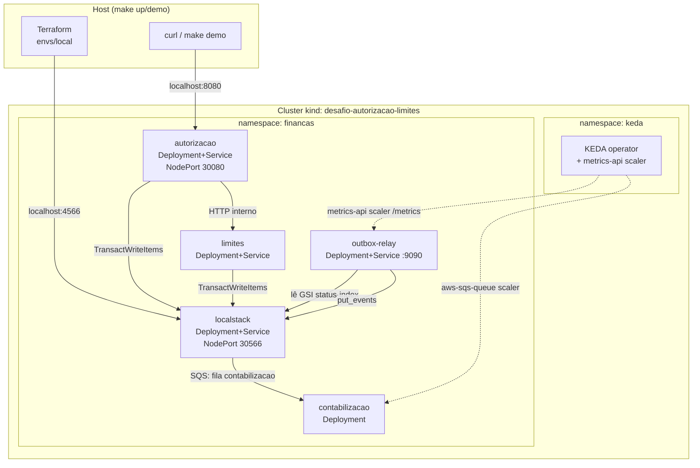
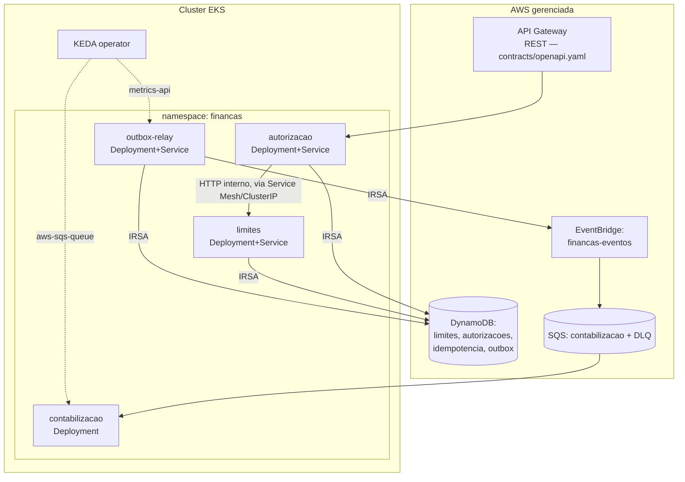

# Topologia de Deployment — Local (kind) vs. Produção (EKS)

## Local (kind + LocalStack)

## Produção (EKS)

## Notas

- A **única diferença estrutural** entre local e produção é a origem do DynamoDB/SQS/EventBridge: LocalStack (containerizado, dentro do próprio cluster kind) vs. AWS real. Os manifestos k8s dos 4 serviços (`deploy/k8s/10-*.yaml` a `30-*.yaml`) são os mesmos nos dois ambientes — apenas `ConfigMap`/`Secret` de endpoint/credenciais mudam (ver ADR 05).
- Em produção, autenticação AWS usa **IRSA** (IAM Roles for Service Accounts) em vez do `Secret aws-local-credentials` fake usado localmente.
- Em produção, o tráfego externo entra via **API Gateway REST** (não exposto diretamente pelo k8s), que roteia para o Service `autorizacao` via um NLB/Ingress — a API local usa NodePort apenas para simplificar o `make demo`.
- A escolha de **EKS em vez de ECS** está documentada na ADR 05, com a justificativa central de domínio do time em Kubernetes/GitOps/KEDA.
